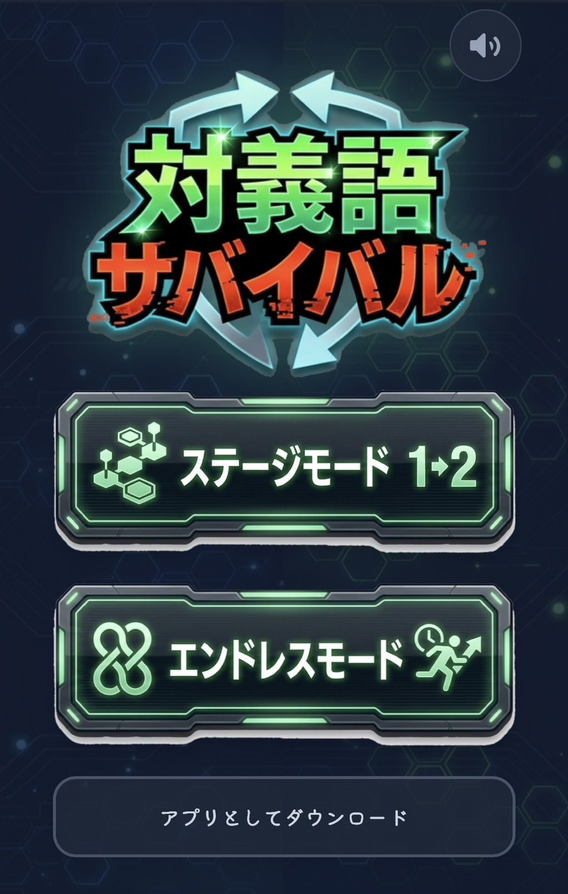
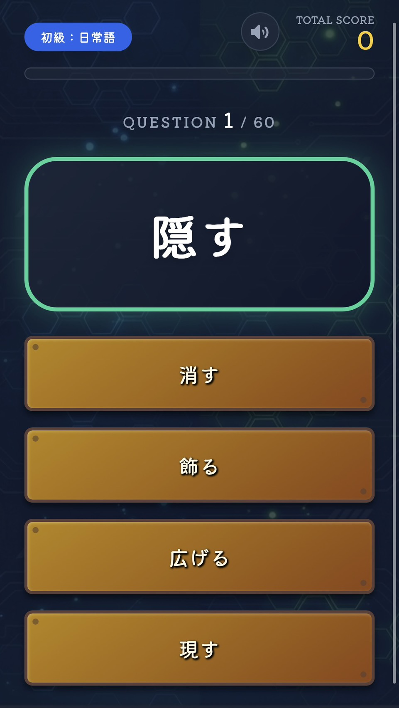

# ⚡️ 対義語サバイバル (Antonym Survival)

[](https://opensource.org/licenses/MIT)


**「言葉の裏側を、瞬時に見抜け。」**

瞬発力と語彙力が試される、究極の対義語クイズサバイバル。  
初級から「地獄級」まで、全200問の難関を突破し、全国ランキングの頂点を目指せ。

---

## 📸 スクリーンショット

| ホーム画面 | プレイ画面 |
| :---: | :---: |
|  |  |

---

## 🎮 ゲームの特徴

- **4つの難易度階層**: 
    - 🟢 **初級**: 日常的な基本語彙
    - 🟡 **中級**: 社会生活で使われる語彙
    - 🔴 **上級**: 抽象概念や難読熟語
    - 🔥 **地獄級**: 業界用語・専門知識・マニアックな対比
- **全国ランキング**: スコアを登録して、全国の猛者と競い合おう！
- **PWA対応**: スマホのホーム画面に追加すれば、いつでもすぐプレイ可能。
- **🆕 v4.0の新機能（2026.11.17）**:
    - 📖 **まちがい帳**: 間違えた問題が自動で貯まる復習モード。正解すると1問ずつ「卒業」！
    - 📤 **結果シェア**: X / Threads / Instagramへ、結果テキストをそのまま投稿できる
    - 🔥 **デイリーストリーク**: デイリーの連続プレイ記録を表示
    - ✨ **レア称号＆季節称号**: 低確率で特別な称号が出現（12月はクリスマス称号も）
    - 📝 **間違いレポート**: ゲームオーバー時に自分の答えと「引っかけポイント」を表示

## 🚀 クイックスタート

1. このリポジトリをクローンまたはダウンロードします。
2. `index.html` をブラウザで開くだけでプレイ可能です。

```bash
git clone https://github.com/bbbb555Creator/taigigo_survival.git
